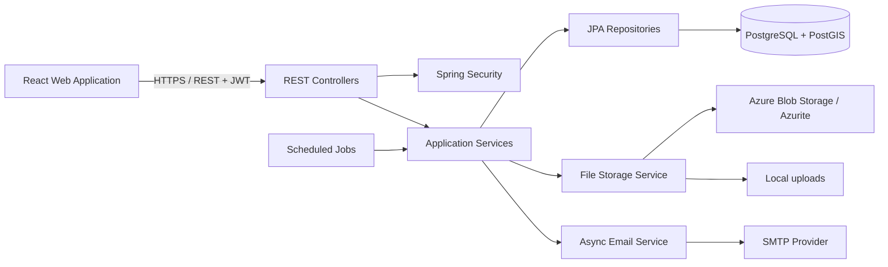
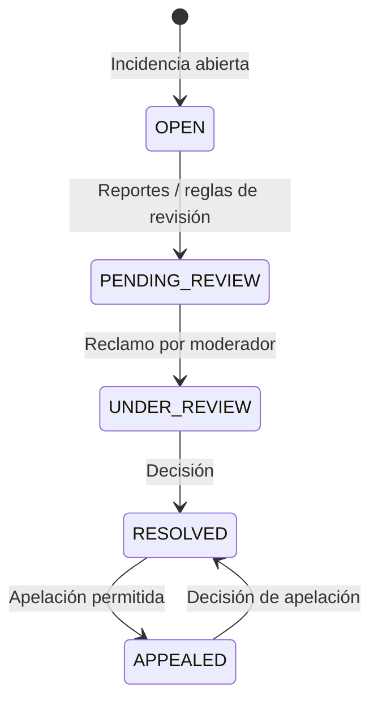
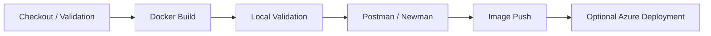

<div align="center">
  
  <h1>Marketplace Link</h1>
  <p><strong>Backend · Marketplace &amp; Trust Management API</strong></p>
  <p>Una plataforma que conecta compradores y vendedores mediante publicaciones de productos y servicios, búsqueda geográfica y mecanismos de moderación.</p>
  <p>
    
    
    
    
    
    
    
  </p>
  <p><a href="https://github.com/DavidJosueP2/Marketplace-Link-Front">Frontend</a> · <a href="#arquitectura">Arquitectura</a> · <a href="#inicio-rápido">Inicio rápido</a> · <a href="#referencia-de-api">API</a> · <a href="#calidad-y-cicd">CI/CD</a></p>
</div>

---

## Descripción

Marketplace Link es una aplicación de intermediación orientada a la publicación y descubrimiento de productos y servicios. Su API REST concentra las reglas de negocio, la persistencia, la autenticación, la gestión de imágenes y el ciclo de revisión de contenido reportado.

El proyecto incorpora un modelo de confianza que permite a los usuarios reportar publicaciones, a los moderadores evaluar incidencias y a los vendedores solicitar una revisión mediante apelaciones. La detección automática de contenido mediante un diccionario de términos complementa la moderación humana.

Este repositorio contiene el **backend**. La interfaz web se mantiene de forma independiente en [Marketplace-Link-Front](https://github.com/DavidJosueP2/Marketplace-Link-Front).

## Funcionalidades

| Módulo | Responsabilidad |
| --- | --- |
| Authentication | Inicio de sesión con JWT, verificación de correo y recuperación de contraseña. |
| User Management | Registro, edición de perfiles, gestión de moderadores, activación y bloqueo de cuentas. |
| Publications | Creación, consulta, actualización y eliminación de publicaciones de tipo `PRODUCT` o `SERVICE`. |
| Discovery | Paginación y filtrado por categorías, precios y distancia geográfica. |
| Favorites | Registro, consulta y eliminación de publicaciones favoritas por usuario. |
| Media Storage | Gestión de imágenes mediante Azure Blob Storage, Azurite o almacenamiento local. |
| Incidences | Reportes de usuarios o del sistema, asignación y decisión de moderadores. |
| Appeals | Solicitud de apelaciones por vendedores, asignación y resolución. |
| Notifications | Envío asíncrono de correos mediante SMTP y plantillas HTML. |
| Scheduled Jobs | Tareas de cierre de incidencias, suspensión de publicaciones y asignación de apelaciones pendientes. |

No se documentan pagos, pedidos, inventario transaccional ni mensajería integrada como funcionalidades implementadas: el alcance comprobado es la gestión de publicaciones y moderación.

## Roles y autorización

Los roles inicializados por `RoleSeeder` son los siguientes:

| Rol | Funciones principales |
| --- | --- |
| `ROLE_BUYER` | Explorar publicaciones, administrar favoritos y reportar contenido. |
| `ROLE_SELLER` | Administrar publicaciones propias, reportar contenido y presentar apelaciones. |
| `ROLE_MODERATOR` | Consultar incidencias, reclamarlas para revisión, emitir decisiones y gestionar apelaciones según asignación. |
| `ROLE_ADMIN` | Administrar cuentas y moderadores, además de las operaciones de moderación autorizadas. |

La autorización efectiva depende de Spring Security, las anotaciones de los controladores y las validaciones de negocio. Algunas rutas mencionan también `SUPER_ADMIN`, pero no forma parte del catálogo inicial del seeder inspeccionado.

## Arquitectura

El backend está organizado como una aplicación Spring Boot por capas, con módulos funcionales de publicaciones, incidencias, apelaciones y usuarios. No requiere un conjunto de microservicios independientes para operar.



**Separación de responsabilidades:** los controladores reciben las solicitudes HTTP; los DTOs definen los datos de intercambio; los servicios coordinan las reglas de negocio; los repositorios realizan consultas y persistencia; los mappers convierten entidades y respuestas. Spring Security controla la identidad y los permisos.

### Stack tecnológico

| Tecnología | Uso |
| --- | --- |
| Java 21 / Spring Boot 3.5.5 | Runtime y framework de la API |
| Spring MVC / Bean Validation | Controladores REST y validación de entradas |
| Spring Security / JJWT | Autenticación JWT y autorización |
| Spring Data JPA / Hibernate | Persistencia relacional |
| PostgreSQL 16 / PostGIS 3.5 | Datos relacionales y consultas espaciales |
| Hibernate Spatial / JTS | Representación y consultas geográficas |
| MapStruct / Lombok | Mapeo de DTOs y reducción de código repetitivo |
| Azure SDK for Java / Azurite | Almacenamiento de objetos y emulación local |
| Spring Mail | Notificaciones por correo |
| Springdoc OpenAPI / Actuator | Documentación y endpoints de salud |
| Maven / Docker / Jenkins | Construcción, empaquetado y automatización |
| JUnit / Mockito / JaCoCo | Herramientas de pruebas y cobertura declaradas en Maven |

## Flujo de moderación

Una incidencia agrupa reportes asociados a una publicación. Puede iniciarse por un usuario o mediante la detección de contenido por el sistema. El moderador reclama una incidencia disponible y emite una decisión. Si las reglas permiten apelar, el vendedor puede solicitar una revisión posterior.



El diagrama sintetiza el recorrido principal y no reemplaza las validaciones de transición del servicio. Un reporte automático puede crear directamente una incidencia `PENDING_REVIEW`.

| Objeto | Estados o decisiones del código |
| --- | --- |
| Incidencia | `OPEN`, `PENDING_REVIEW`, `UNDER_REVIEW`, `APPEALED`, `RESOLVED` |
| Decisión de incidencia | `PENDING`, `APPROVED`, `REJECTED` |
| Apelación | `PENDING`, `ASSIGNED`, `FAILED_NO_MOD`, `REVIEWED` |
| Decisión de apelación | `PENDING`, `ACCEPTED`, `REJECTED` |

Las decisiones pueden afectar la disponibilidad de la publicación según las reglas de negocio. Las tareas programadas permiten gestionar incidencias y apelaciones pendientes sin depender únicamente de acciones manuales.

## Estructura del repositorio

```text
Marketplace_Link/
├── src/
│   ├── main/
│   │   ├── java/com/gpis/marketplace_link/
│   │   │   ├── config/         # Configuración general
│   │   │   ├── dto/            # Request y response DTOs
│   │   │   ├── entities/       # Entidades JPA
│   │   │   ├── enums/          # Estados, tipos y decisiones
│   │   │   ├── exceptions/     # Errores y manejadores
│   │   │   ├── jobs/           # Scheduled jobs
│   │   │   ├── mail/           # Modelos de notificaciones
│   │   │   ├── mappers/        # Mapeo de entidades y DTOs
│   │   │   ├── repositories/   # Persistencia y consultas
│   │   │   ├── rest/           # REST controllers
│   │   │   ├── security/       # Filtros, roles y configuración JWT
│   │   │   └── services/       # Reglas de negocio e integraciones
│   │   └── resources/          # Perfiles, diccionario y plantillas
│   └── test/                   # Pruebas Java
├── docker/init.sql             # Inicialización PostgreSQL/PostGIS
├── .env.example                # Plantilla de configuración
├── docker-compose.yml          # Infraestructura de desarrollo
├── docker-compose.back.yml     # Infraestructura y backend
├── Dockerfile                  # Build multi-stage de la API
├── Jenkinsfile                 # Pipeline CI/CD
├── AZURITE_SETUP.md
├── JENKINSFILE_DOCUMENTATION.md
└── pom.xml
```

## Inicio rápido

### Requisitos

- JDK 21 y Maven Wrapper incluido (`mvnw` / `mvnw.cmd`).
- Docker Engine o Docker Desktop con Docker Compose v2.
- Git.
- Proveedor SMTP configurado si se desean probar correos reales.

### 1. Clonar y configurar

```bash
git clone https://github.com/DavidJosueP2/Marketplace_Link.git
cd Marketplace_Link
cp .env.example .env
```

En PowerShell, sustituir el último comando por `Copy-Item .env.example .env`.

Completar los valores privados de SMTP y almacenamiento en `.env` antes de ejecutar. No reutilizar contraseñas de ejemplo fuera del entorno local.

### 2. Ejecutar con Docker Compose

La variante `docker-compose.back.yml` incluye la API, PostgreSQL, una base de pruebas y Azurite. Utilizarla para iniciar el conjunto local:

```bash
docker compose -f docker-compose.back.yml up -d --build
docker compose -f docker-compose.back.yml ps
docker compose -f docker-compose.back.yml logs -f mplink-backend
```

| Servicio | Dirección local de esta variante |
| --- | --- |
| Backend REST | `http://localhost:8080` |
| PostgreSQL principal | `localhost:5438` |
| PostgreSQL de pruebas | `localhost:5439` |
| Azurite Blob | `http://localhost:10000` |
| Azurite Queue / Table | `localhost:10001` / `localhost:10002` |

El Compose está pensado para desarrollo y contiene credenciales de ejemplo y configuración de puertos fija. Revisar sus valores antes de usarlo; no exponer estos servicios a Internet. No ejecutar simultáneamente las dos variantes de Compose si sus puertos entran en conflicto.

### 3. Ejecutar la API desde el IDE o Maven

Como alternativa, iniciar únicamente la infraestructura con `docker-compose.yml`. Configurar los puertos publicados mediante `DB_PORT` y `DB_PORT_TEST` en `.env` (por ejemplo, 5436 y 5437), asegurándose de que sean distintos. Para la aplicación que corre en el host, usar `DB_HOST=localhost`, `DB_HOST_TEST=localhost` y los puertos externos correspondientes; el endpoint Azurite deberá usar `localhost:10000`.

```bash
docker compose up -d
./mvnw spring-boot:run -Dspring-boot.run.profiles=dev
```

En Windows:

```powershell
.\mvnw.cmd spring-boot:run '-Dspring-boot.run.profiles=dev'
```

> Spring Boot no importa automáticamente el archivo `.env` como variables del proceso. Al ejecutar Maven fuera de Docker, cargar las variables en la terminal o mediante la configuración de ejecución del IDE. El esquema base se prepara con `docker/init.sql`; los perfiles principal y dev utilizan `ddl-auto: validate`.

### Variables de entorno

| Variable | Finalidad |
| --- | --- |
| `DB_HOST`, `DB_PORT`, `DB_NAME`, `DB_USER`, `DB_PASSWORD` | Conexión a la base de datos principal |
| `DB_HOST_TEST`, `DB_PORT_TEST`, `DB_NAME_TEST`, `DB_USER_TEST`, `DB_PASSWORD_TEST` | Conexión de pruebas aislada |
| `SERVER_PORT` | Puerto HTTP (8080 en el Compose completo) |
| `FRONTEND_URL` | Orígenes permitidos y configuración del cliente |
| `MAIL_HOST`, `MAIL_PORT`, `MAIL_USERNAME`, `MAIL_PASSWORD` | Proveedor SMTP |
| `AZURE_STORAGE_ENABLED` | Habilitar Blob Storage o utilizar disco local |
| `AZURE_STORAGE_CONNECTION_STRING` | Credenciales y endpoint del almacenamiento, solo backend |
| `AZURE_STORAGE_CONTAINER_NAME` | Nombre del contenedor de imágenes |
| `SUSPENDED_TIME_DAYS` | Configuración temporal de suspensión |
| `MODERATOR_DEFAULT_PASSWORD` | Contraseña inicial configurada para moderadores |

Para Azure real, reemplazar el connection string del emulador por uno del entorno correspondiente y configurar accesos apropiados. Consultar [AZURITE_SETUP.md](AZURITE_SETUP.md) para inicializar y explorar el contenedor de blobs.

## Referencia de API

URL base local: `http://localhost:8080`.

| Método | Endpoint | Operación |
| --- | --- | --- |
| POST | `/login` | Obtener token JWT |
| POST | `/api/users` | Registrar usuario |
| GET | `/api/auth/profile` | Consultar perfil |
| GET | `/api/auth/verify-email` | Verificar correo con token |
| POST | `/api/auth/password/forgot` | Solicitar recuperación |
| POST | `/api/auth/password/reset` | Restablecer contraseña |
| GET | `/api/categories` | Consultar categorías |
| GET | `/api/publications` | Listar publicaciones con filtros |
| GET | `/api/publications/{id}` | Consultar detalle |
| GET | `/api/publications/by-vendor` | Consultar publicaciones del vendedor |
| POST | `/api/publications` | Crear publicación (multipart) |
| PUT | `/api/publications/{id}` | Actualizar publicación (multipart) |
| DELETE | `/api/publications/{id}` | Eliminar publicación |
| GET | `/api/users/favorites` | Listar favoritos |
| POST / DELETE | `/api/publications/{id}/favorite` | Añadir o eliminar favorito |
| GET | `/api/publications/{id}/favorite/check` | Comprobar favorito |
| POST | `/api/incidences/report` | Reportar publicación |
| GET | `/api/incidences/all` | Consultar incidencias del sistema |
| GET | `/api/incidences/my` | Consultar incidencias asignadas |
| POST | `/api/incidences/claim` | Reclamar incidencia |
| POST | `/api/incidences/decision` | Resolver incidencia |
| POST | `/api/incidences/appeal` | Presentar apelación |
| GET | `/api/appeals/my` | Consultar apelaciones |
| POST | `/api/appeals/decision` | Resolver apelación |
| GET | `/actuator/health` | Estado de salud |

Las rutas tienen requisitos de autenticación y roles específicos. Para solicitudes protegidas, enviar `Authorization: Bearer <token>`.

Ejemplo de filtro geográfico, con coordenadas ilustrativas:

```bash
curl 'http://localhost:8080/api/publications?page=0&size=12&lat=-1.25&lon=-78.62&distanceKm=10&minPrice=0&maxPrice=200' \
  -H 'Authorization: Bearer YOUR_TOKEN'
```

Documentación interactiva: [Swagger UI](http://localhost:8080/swagger-ui.html) y [OpenAPI JSON](http://localhost:8080/v3/api-docs).

## Calidad y CI/CD

El `pom.xml` declara herramientas para pruebas con Spring Boot Test, Mockito y Spring Security Test, cobertura JaCoCo, Selenium, JMeter, Sonar y ZAP. Su presencia no acredita resultados ni cobertura alcanzada.

```bash
./mvnw clean test
./mvnw clean verify
./mvnw clean package -DskipTests
```

Configurar primero el perfil de pruebas y una base PostgreSQL/PostGIS independiente: el perfil `test` usa `ddl-auto: create-drop` y no debe apuntar a datos reales.

El `Jenkinsfile` define un pipeline parametrizado que contempla:



Las etapas dependen de los parámetros y credenciales de Jenkins. La definición incluye publicación de imágenes y despliegue opcional a Azure Container Apps. Ver [JENKINSFILE_DOCUMENTATION.md](JENKINSFILE_DOCUMENTATION.md).

## Seguridad y consideraciones de despliegue

- JWT y controles de rol se aplican junto con validaciones de negocio; revisar permisos de propiedad de recursos antes de producción.
- El detector por diccionario es un mecanismo auxiliar: no garantiza que todo contenido prohibido se identifique correctamente.
- Sustituir cuentas y contraseñas de demostración del seeder y de Compose. Revisar la gestión del secreto JWT, el nivel de logging y la exposición de Actuator y Swagger.
- Utilizar HTTPS, credenciales externas a Git, CORS restringido y políticas apropiadas de acceso a los blobs.
- El Dockerfile usa un usuario no root y contiene un healthcheck; los servicios de desarrollo no equivalen a un despliegue endurecido.
- No se ha validado una cobertura de pruebas, ejecución exitosa de CI/CD ni un entorno productivo activo en esta documentación.

## Repositorios y documentación

| Recurso | Enlace |
| --- | --- |
| Backend | [Marketplace_Link](https://github.com/DavidJosueP2/Marketplace_Link) |
| Frontend | [Marketplace-Link-Front](https://github.com/DavidJosueP2/Marketplace-Link-Front) |
| Emulación de Azure Storage | [AZURITE_SETUP.md](AZURITE_SETUP.md) |
| Pipeline Jenkins | [JENKINSFILE_DOCUMENTATION.md](JENKINSFILE_DOCUMENTATION.md) |

## Contribución

Crear una rama para cada cambio, mantener la configuración sensible fuera del control de versiones y verificar las pruebas pertinentes antes de abrir un pull request. Consultar el historial y la sección de [contribuidores](https://github.com/DavidJosueP2/Marketplace_Link/graphs/contributors) para conocer las aportaciones del equipo.

No se identifica un archivo `LICENSE` en la rama revisada; no se presupone una licencia de distribución.

---
<div align="center"><strong>Marketplace Link</strong><br />Marketplace · Moderation · Trust</div>
